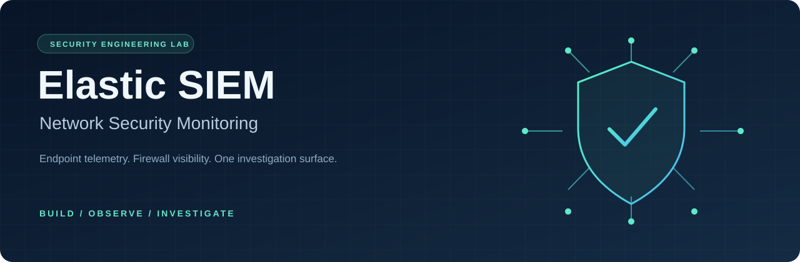
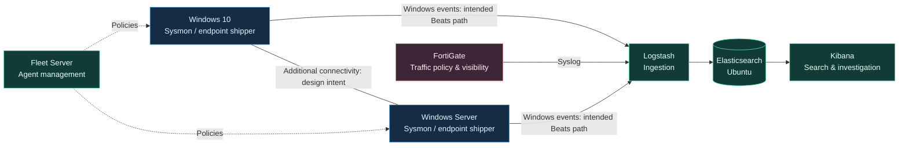

**Built from scratch. Connected across endpoints. Designed for visibility.**

[Architecture](docs/architecture.md) · [Build guide](docs/build-guide.md) · [Attack simulations](docs/attack-simulations.md) · [Evidence & results](docs/evidence.md)

---

## The mission

Build a complete security monitoring environment from the ground up: collect Windows endpoint events, ingest FortiGate firewall logs, centralize telemetry in Elasticsearch, and use Kibana to investigate suspicious activity.

The lab brings together an **Ubuntu-hosted Elastic Stack**, **Windows 10**, **Windows Server**, and a **FortiGate firewall**. Controlled Nmap reconnaissance and Hydra password-attack exercises explore how endpoint and network telemetry can support detection. Alternative communication paths are part of the resilience design—not a claim of automatic failover or a highly available SIEM.

> **Project status:** documentation-first lab showcase. This repository contains architecture, operator guidance, investigation examples, and validation plans—not a one-command deployment. Reported lab work, supplied screenshot evidence, and proposed improvements are explicitly distinguished.

## At a glance

| Layer | Components | Purpose |
| :--- | :--- | :--- |
| **Platform** | Ubuntu · Elasticsearch · Kibana | Store, search, and investigate security events |
| **Management** | Fleet Server · Elastic Agent | Central enrollment and policy management |
| **Endpoints** | Windows 10 · Windows Server 2016 · Sysmon · Winlogbeat | Generate and forward endpoint telemetry |
| **Ingestion** | Logstash · syslog · Beats | Receive and route firewall and Windows events |
| **Network** | FortiGate · VMware networking | Enforce policy and expose network activity |
| **Validation** | Kali Linux · Nmap · Hydra · NetExec | Exercise visibility inside the authorized lab |

## How it fits together

*Logical telemetry view, not a physical wiring diagram. Agent management is distinct from event delivery; the Windows-to-Windows link does not establish a log relay. See [architecture and resilience boundaries](docs/architecture.md).*

## What the lab demonstrates

- **Platform engineering:** installation and configuration of Elasticsearch, Kibana, Fleet Server, and Logstash on Ubuntu.
- **Endpoint instrumentation:** Sysmon configuration on Windows 10 and Windows Server; Winlogbeat service setup and connectivity testing.
- **Firewall integration:** FortiGate policy configuration and syslog forwarding into the central ingestion tier.
- **Central ingestion:** the supplied report shows populated `fortigate-*` and `windows-*` indices.
- **Security exercises:** Nmap service discovery, Hydra SMB attempts, and supplementary Metasploit/NetExec activity.
- **Resilience thinking:** separate endpoint and firewall telemetry paths, with explicit tests still needed for outages, buffering, and recovery.

### Evidence, not assumptions

| Capability | Current evidence level |
| :--- | :--- |
| Elastic platform & Fleet Server | Service checks, node response, and healthy Fleet Server shown in the supplied report |
| Firewall and Windows indices | Populated indices shown; this does not prove every endpoint/channel is healthy |
| Windows 10 → Logstash | TCP/5044 check **failed** in the captured test; later success is not shown |
| Endpoint Elastic Agent deployment | Reported by the project author; report screenshots confirm Fleet Server, not both endpoint enrollments |
| Attack detection & analysis | Reported by the author; rule creation, alert matches, and investigation screenshots are not supplied |
| Alternative-path failover | Design objective; routing, relay configuration, and outage tests are not evidenced |

The [evidence register](docs/evidence.md) preserves the important gaps, including a Windows input protocol mismatch and inconsistent syslog ports in the source report.

## Explore the project

| Start here | What you will find |
| :--- | :--- |
| [Architecture & resilience](docs/architecture.md) | Data paths, trust boundaries, ports, and failure scenarios |
| [Build guide](docs/build-guide.md) | Ordered setup workflow and secure configuration decisions |
| [Validation runbook](docs/validation.md) | Health checks, troubleshooting, and recovery test acceptance criteria |
| [Attack simulations](docs/attack-simulations.md) | Authorized exercise workflow and honest outcome summaries |
| [Investigation queries](examples/investigation-queries.md) | Starter KQL queries and field-mapping caveats |
| [Evidence & results](docs/evidence.md) | Source references, known issues, and evidence still needed |
| [Team responsibilities](docs/team.md) | SOC Engineer, Network Security, and SOC Analyst tracks |

## Build workflow

1. **Isolate** an authorized lab and define a consistent addressing/port plan.
2. **Deploy** Elasticsearch and Kibana on Ubuntu with authentication and trusted TLS.
3. **Enroll** Fleet Server and the intended endpoint agents; select one collection strategy per channel.
4. **Instrument** Windows with Sysmon and configure compatible event forwarding.
5. **Integrate** FortiGate syslog through Logstash and verify indexed events.
6. **Exercise** the lab with controlled simulations, then correlate source events and alerts.
7. **Validate** failure scenarios using event IDs, timestamps, and recovery evidence.

See the [build guide](docs/build-guide.md) before changing hosts. Version numbers and addresses in the source report are historical observations, not a supported release recommendation or a reusable topology.

## Next milestones

- [ ] Reconcile FortiGate sender and collector ports; document the chosen transport.
- [ ] Correct the captured Windows UDP input to a compatible Beats/TCP listener and retest.
- [ ] Capture healthy endpoint enrollments and per-host/per-channel ingestion.
- [ ] Add sanitized detection rules, dashboards, and attack-to-alert investigation evidence.
- [ ] Validate endpoint buffering, firewall log retention, and post-outage replay.
- [ ] Demonstrate any Windows relay or alternative routing path explicitly.

## Safe use & contributions

All offensive activity belongs **only in an isolated, explicitly authorized environment**. Prefer host-only or isolated virtual networks for repeatable exercises; bridged networking in the source report must not be treated as safe isolation.

See [contributing](CONTRIBUTING.md) for documentation and evidence standards, and [security guidance](SECURITY.md) before sharing captures or configurations. The original source PDF is intentionally not republished: its screenshots may contain passwords, enrollment tokens, and other sensitive setup material. This repository does not claim a license for third-party software or the supplied report.
