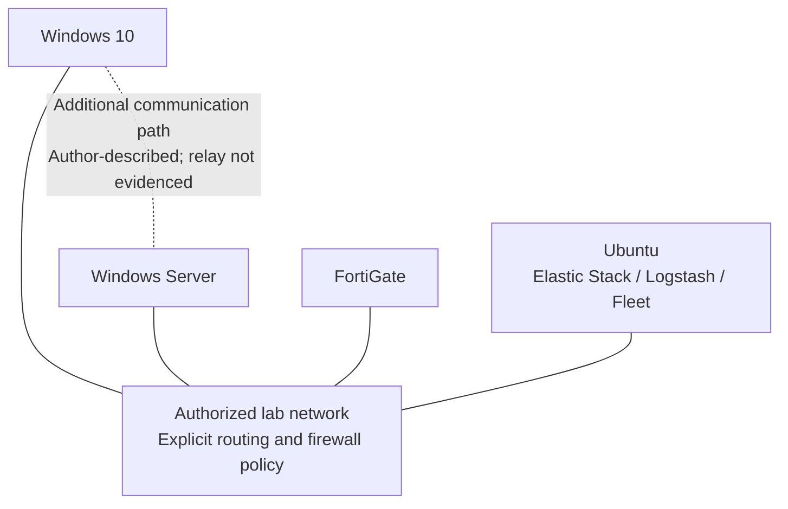

# Architecture & resilience

[← Project overview](../README.md)

## Design intent

The Ubuntu host provides centralized collection, storage, and analyst access. Windows 10 and Windows Server produce endpoint events, while FortiGate provides independent network visibility. The author describes an additional Windows-to-Windows connection to support communication during failures.

These are **logical roles**, not proof of a complete redundant routing topology. A physical or virtual link alone cannot relay logs: forwarding services, routes, firewall rules, credentials, buffering, and failure detection must also exist.

## Two planes, different responsibilities

| Plane | Path | Important distinction |
| --- | --- | --- |
| Management | Endpoint Elastic Agent ↔ Fleet Server | Enrollment and policy delivery do not prove event ingestion |
| Endpoint data | Windows Event Log / Sysmon → shipper → collector → Elasticsearch | Report evidence includes Winlogbeat; Elastic Agent endpoint deployment is author-reported |
| Firewall data | FortiGate → syslog → Logstash → Elasticsearch | Separate from Windows event forwarding |
| Investigation | Analyst → Kibana → Elasticsearch | Searchable records do not automatically imply detection rules or alerts |

Elastic Agent and standalone Winlogbeat are not interchangeable configurations. Choose one collector per event channel unless deliberate duplication is documented. Fleet output settings determine the actual Elastic Agent data path; this repository does not assert that every agent uses Logstash.

## Logical network relationships

This deliberately avoids inventing interface assignments, redundant gateways, or a single IP scheme. Source captures contain multiple subnets and appear to represent different setup stages.

## Port plan to verify

These are defaults or source observations, **not a deployable firewall policy**. Restrict source hosts and use the chosen transport consistently.

| Service | Transport / port | Scope and caveat |
| --- | --- | --- |
| Elasticsearch API | TCP/9200 over HTTPS | Collector, Kibana, and authorized administration only |
| Kibana | TCP/5601 | Analyst/admin access; configure HTTPS or a trusted TLS proxy |
| Fleet Server | TCP/8220 over HTTPS | Enrolled agents; validate certificates |
| Logstash Beats input | TCP/5044, TLS recommended | Correct protocol for Winlogbeat `output.logstash` |
| FortiGate syslog | UDP/514 in source sender; UDP/5514 in a validation capture | Unresolved discrepancy; explicitly align sender/listener or document forwarding |

The report's Windows Logstash example uses `udp { port => 5044 }`. That is **not** a Beats listener and cannot receive Winlogbeat's Beats-over-TCP output. Populated `windows-*` indices do not resolve this protocol inconsistency or prove Windows 10 delivery.

## Failure behavior: goals versus guarantees

| Failure | Intended remaining visibility | Conditions / limits |
| --- | --- | --- |
| FortiGate unavailable | Endpoint events may still reach Elastic | Only if endpoint-to-collector routing does not depend on the failed firewall |
| Ubuntu/Elastic unavailable | FortiGate may continue local traffic monitoring | Requires firewall operation and configured logging storage; central search and alerts are unavailable |
| Windows 10 loses its primary path | Windows Server may offer another communication path | Requires proven routing or a configured relay; no such forwarding evidence is supplied |
| Logstash unavailable | Sources may buffer and retry | Queue sizes, disk availability, transport behavior, and replay must be configured and tested |
| Elasticsearch unavailable | Ingestion may queue temporarily | Single Ubuntu host remains a failure domain; this is not cluster HA |

UDP syslog has no delivery acknowledgment or inherent replay. Logstash persistent queues cannot recover datagrams lost before receipt. Firewall traffic inspection also does not guarantee durable local log storage.

## Security boundaries

- Keep attack VMs and intentionally exposed services away from production networks.
- Restrict API, management, and collector ports to required peers.
- Verify TLS certificates; do not copy the source's disabled certificate verification.
- Use dedicated, least-privilege ingestion identities instead of the `elastic` superuser.
- Synchronize all clocks before testing; the source shows a FortiGate time-sync warning.
- Treat logs as sensitive data and define retention and storage limits.

Next: [build guide](build-guide.md) · [failure validation](validation.md)
