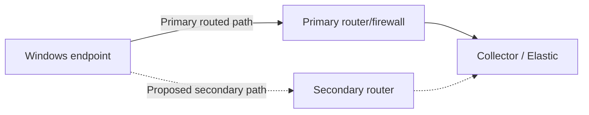
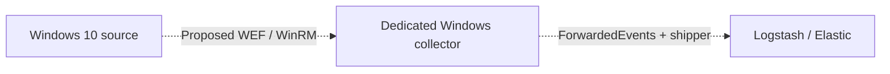

# Backup lines: purpose, identification & configuration

[← Overview](../README.md) · [Device configuration](configuration.md)

## What is a backup line?

A backup line is an **alternative usable path for a defined service when its primary path fails**. It might be another routed network path, a separate collector, or a deliberate event relay. It is not simply a line drawn between two devices.

The project author's idea is to avoid losing all visibility when one component or connection fails. Endpoint events and firewall traffic logs provide complementary views. However, **separate telemetry sources are not automatically redundant transport**, and continuing local firewall monitoring is not the same as keeping the central SIEM available.

No working automatic failover, Windows relay, or outage/replay result is demonstrated in the supplied PDF. The designs below are proposed implementation options.

## 1. Inventory the real paths first

For every cable/virtual NIC, record:

| Field | What to identify |
| --- | --- |
| Path ID | A stable name, e.g. P1 endpoint-to-collector |
| Service | Windows events, firewall syslog, Fleet management, or analyst UI |
| Endpoints | Source/destination IP and service port/protocol |
| Links | NIC, switch/VMnet, VLAN, gateway, next hop, interface role |
| Dependencies | Firewall, hypervisor, physical NIC, DNS, collector, power/storage |
| Selection | Static route metric, monitored route, service output policy, or manual action |
| Failure test | What is removed/stopped and how receipt is measured |
| Recovery | Replay behavior, loss tolerance, failback and rollback |

Two virtual NICs on the same VMnet/physical uplink are not independent of that VMnet/uplink. Two paths to the same Ubuntu machine still share its compute, storage, Logstash and Elasticsearch failure domain.

### Inspect before configuring

```powershell
Get-NetAdapter
Get-NetIPConfiguration
Get-NetRoute -AddressFamily IPv4 | Sort-Object DestinationPrefix,RouteMetric
Get-NetIPInterface -AddressFamily IPv4
Find-NetRoute -RemoteIPAddress YOUR_COLLECTOR_IP
Test-NetConnection YOUR_COLLECTOR_IP -Port 5044 -InformationLevel Detailed
tracert -d YOUR_COLLECTOR_IP
```

```bash
ip -br addr
ip route
ip route get YOUR_WINDOWS_IP
ss -lntup
```

On FortiGate inspect the routing table, interface state, policies, and any configured SD-WAN/health checks. Traceroute can be filtered and same-subnet traffic may not traverse a router; combine route inspection with packet/event evidence.

## 2. Option A — alternate routed network path

**Idea:** the Windows shipper still connects to the same collector, but IP packets use a different route when the primary route is withdrawn.



### Configuration sequence

1. Provide an actually independent subnet/link and a reachable secondary gateway. Use separate routed segments for predictable next-hop selection.
2. Enable forwarding on a suitable router with narrow policies. Do not assume a Windows Server/DC forwards packets by default.
3. Install the required routes on both sides, including collector return routes. Avoid a design where outbound traffic uses one firewall while replies traverse a stateful firewall without matching session state.
4. Prefer a narrow collector host route or service subnet route over adding multiple unexplained default gateways.
5. Set the primary route preference ahead of the backup. In Windows, route and interface metrics both influence selection among equal-prefix routes. Longest prefix wins before metric.
6. Add health monitoring and route withdrawal or an explicit manual switchover procedure. **A higher-metric route is not enough:** if the primary NIC stays up while an upstream router/collector fails, its route may remain selected.
7. Test both physical/link failure and upstream blackhole failure; verify actual event delivery, not only a changed route table.

An example Windows **manual alternate-route** command shape is shown below. It is deliberately not a runnable final configuration:

```powershell
# Replace ALL placeholders; execute only with console access and rollback prepared.
New-NetRoute -DestinationPrefix "COLLECTOR_IP/32" `
  -InterfaceIndex SECONDARY_INTERFACE_INDEX -NextHop "SECONDARY_GATEWAY_IP" `
  -RouteMetric 50 -PolicyStore PersistentStore
```

The secondary next hop must be reachable on that interface; choose a primary preference consistent with actual interface metrics. Record the created route's prefix, next hop and interface so it can be removed precisely if needed. This command alone does not implement monitored failover.

If FortiGate manages two routed uplinks, version-appropriate SD-WAN or link-monitoring may provide health-based selection. Configure both members, service health probes, preferred-path rules, firewall policies, return routing, and failback. A probe should represent the intended destination/service as closely as supported; gateway ping alone may remain healthy while ingestion is broken. Exact CLI depends on the final interface topology and FortiOS version, so the PDF is insufficient for a safe ready-to-run SD-WAN configuration.

**Limit:** a backup route cannot make a failed collector or Elasticsearch service available.

## 3. Option B — Windows event relay through another server

**Idea:** the server accepts selected endpoint events and forwards them onward. This changes the **application path**, not merely the route.



A Windows Event Forwarding (WEF) design is one possible implementation. It is **not demonstrated in the PDF**, and WEF is not a transparent relay for an arbitrary existing Beats connection.

### Configuration sequence

1. Prefer a dedicated member server as the collector rather than adding collection/routing duties to the domain controller.
2. Configure the Windows Event Collector service, controlled WinRM access, authentication, and scoped firewall rules. Domain authentication or HTTPS certificate configuration must be appropriate to the environment; do not enable insecure broad WinRM access.
3. Create a source-initiated or collector-initiated subscription with explicit source permissions and the required channels. Use Event Viewer → Subscriptions and policy-based subscription manager configuration as appropriate.
4. Configure permissions for Security/Sysmon channels where needed. Prove the exact required channels can be forwarded; a subscription existing is not delivery evidence.
5. Verify original events in the collector's `ForwardedEvents` channel and preserve original computer identity and event times.
6. Configure the collector's shipper to read `ForwardedEvents`, with forwarding-aware/rendering settings appropriate to the shipper version. Forward to the central collector using authenticated TLS.
7. Check capacity, subscription state/bookmarks, event log size and rollover, output queue limits, and outages in both directions.
8. Match a unique Windows 10 source event to its forwarded copy and indexed document. Ensure the originating host is not incorrectly attributed to the collector.

### Why this is not automatically a backup

Running direct collection and WEF collection simultaneously may duplicate events. Switching between them requires a deliberate activation policy, a safe overlap window, original record identity tracking, and deduplication design. If WEF is the only path, it is an alternative architecture—not a standby path. If both routes share the same broken NIC or firewall, neither helps that failure.

Do not describe the server as "forwarding Windows 10 logs" until the subscription, collector channel, shipper input, and indexed source identity are all demonstrated.

## 4. Option C — durable buffering, not another line

Endpoint queues and retained event logs, Logstash persistent queues, and configured FortiGate local storage can reduce loss during interruptions. They do not create a network path or central service availability.

- Configure retention/queue limits, disk use, retry behavior and monitoring explicitly.
- Estimate capacity from event rate × outage duration × average event size, with overhead and a safety margin.
- Verify log rollover and backlog recovery; a finite buffer eventually fills.
- UDP syslog lost before collector receipt cannot be restored by a downstream Logstash queue.
- FortiGate inspection can continue during an Elastic outage, but retention and later export/replay depend on actual logging facilities and transport configuration.

## 5. Failure-to-backup mapping

| Failure | What may help | What does not solve it |
| --- | --- | --- |
| Primary endpoint route/link fails | Truly independent routed path or reachable relay | Another source on the same failed link |
| FortiGate fails | Endpoint path not dependent on that firewall | Merely drawing a direct endpoint-to-Elastic arrow |
| Logstash service fails | Tested source buffering or a separately designed collector path | A second route to the same dead listener |
| Ubuntu host fails | Local source retention; separately deployed service redundancy | Windows Server connectivity alone |
| Elasticsearch fails | Tested ingestion buffering; designed cluster/service redundancy | FortiGate local traffic inspection as a replacement for SIEM |
| Domain services fail | Appropriate authentication/service recovery design | Treating `STATUS_NO_LOGON_SERVERS` as just a bad password |

## 6. Prove and label backup lines

Assign each candidate path one of these states:

- **Drawn:** intended topology only.
- **Configured:** interfaces/routes or relay settings exist.
- **Reachable:** the required transport works through that path.
- **Validated:** identifiable events arrive during a controlled primary failure.
- **Recovery-tested:** loss, duplicates, replay latency and failback measured.

For each path, generate uniquely identifiable benign events before/during/after a failure; record the actual route, listener, source record IDs, received IDs, timing and duplicates. Restore the primary path and verify stable failback. Publish its status and tested failure scope alongside the diagram.

Until these steps pass, label the project's Windows-to-Windows backup line **design intent / not validated**, not automatic failover or zero-loss logging.
