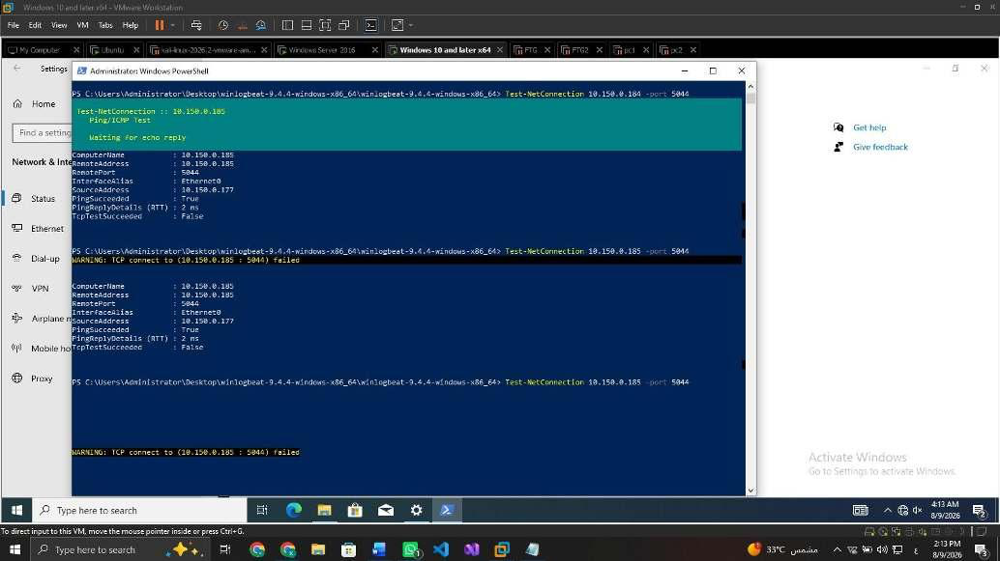
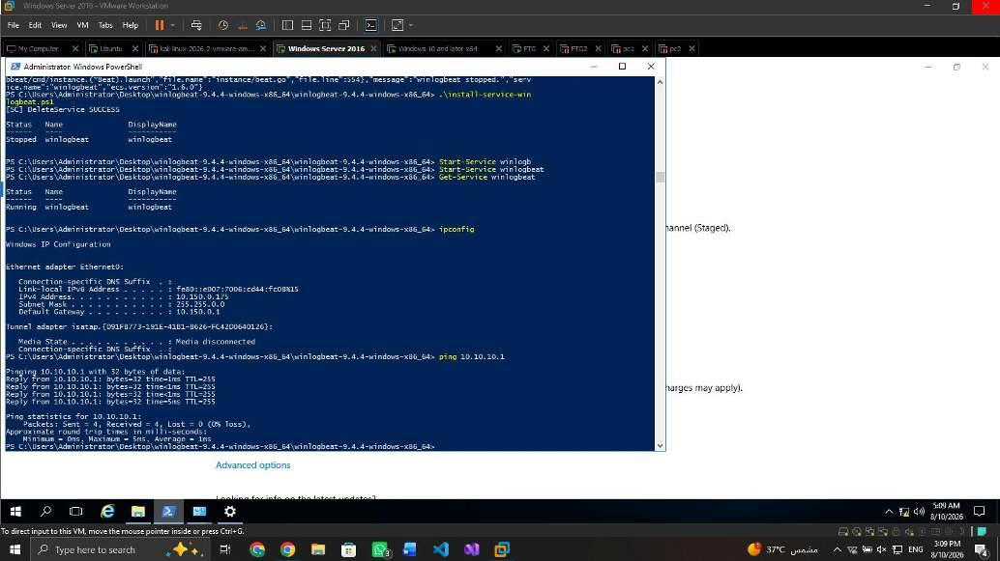
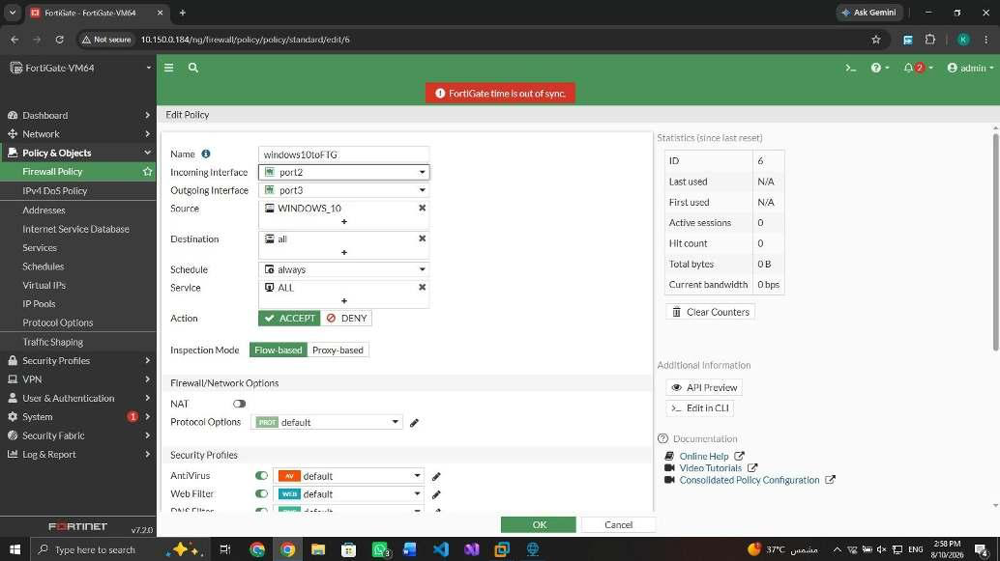
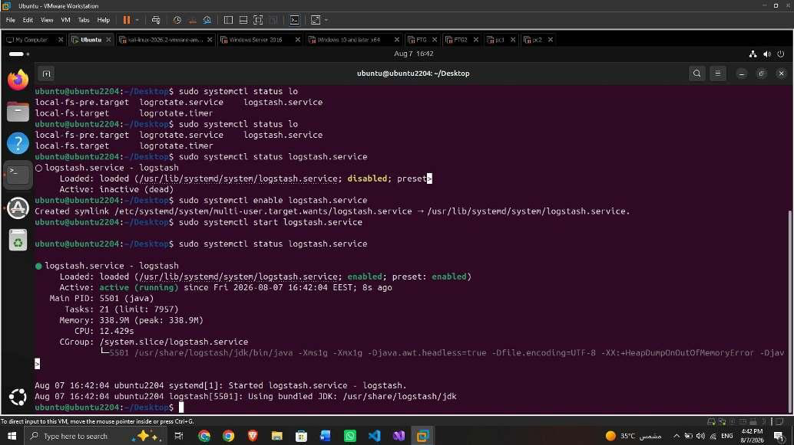

# Configuration screenshots from the supplied PDF

[← Overview](../README.md) · [Detailed configuration](configuration.md) · [Evidence register](evidence.md)

These are **real screenshot excerpts from the user-supplied report**, not generated illustrations and not new executions. They are cropped to the screenshot areas, rasterized as PNGs, and visually reviewed for visible passwords, enrollment tokens and keys. No such secrets were visible in the selected excerpts; no content was altered to change results. Lab IP addresses, hostnames and historical UI details are intentionally retained for technical explanation. Review these details against your disclosure policy before public release.

Source: `SOC_Lab_Documentation_Revised_Task_Distribution.pdf`, revised task distribution, 34 pages. Page numbers below are PDF page numbers. The complete PDF and unselected setup captures remain excluded from Git because other pages may contain sensitive setup material. This is not a license grant for the report or vendor interfaces.

## 1 · Windows 10: test the collector port

**Source:** page 19, Figure 25. **File:** `assets/evidence/windows10-connectivity.png`.

The source machine is shown as `10.150.0.177` and the destination is `10.150.0.185:5044`. Ping succeeds, while `TcpTestSucceeded` is false. This is an excellent troubleshooting example: a reachable host is not necessarily a reachable ingestion service. Check listener protocol/bind address, host firewall, network policy, and routes before claiming successful Windows 10 delivery.

## 2 · Windows Server: shipper service and networking

**Source:** page 21, Figure 27. **File:** `assets/evidence/windows-server-connectivity.png`.

The screenshot shows Winlogbeat service startup/checks, `10.150.0.175` addressing, and replies from `10.10.10.1`. It supports local service health and gateway reachability at that moment. It does not establish direct Windows 10-to-Server delivery, a relay subscription, domain promotion completion, or failover.

## 3 · FortiGate: traffic policy

**Source:** page 22, Figure 42. **File:** `assets/evidence/fortigate-policy.png`.

The policy shows `port2` → `port3`, source `WINDOWS_10`, ACCEPT, flow-based inspection, NAT off, and default security profiles. Destination/service are broad historical settings, not least-privilege recommendations. The visible time-sync warning is relevant to correlation. The policy screen is not an attack alert, and it does not prove syslog ingestion or backup-link selection.

## 4 · Ubuntu: Logstash service startup

**Source:** page 26, Figure 34. **File:** `assets/evidence/elastic-logstash-service.png`.

The terminal moves from inactive/disabled to enabled and active. It supports Logstash process health, not successful parsing, correct TLS, event receipt, or indexing. Use end-to-end event identity checks to validate the full path.

## Why no backup-line screenshot?

The report does not show redundant route configuration, a WEF relay subscription, monitored failover, or a timed outage/replay test. A photo would not fill that evidence gap. [Backup-line designs](backup-lines.md) are therefore labeled proposed and include validation steps instead of being presented as completed configurations.
